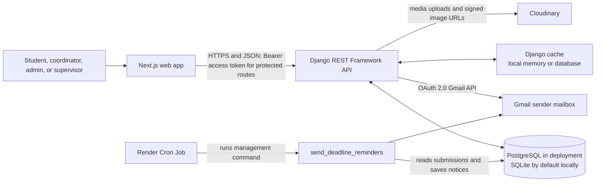
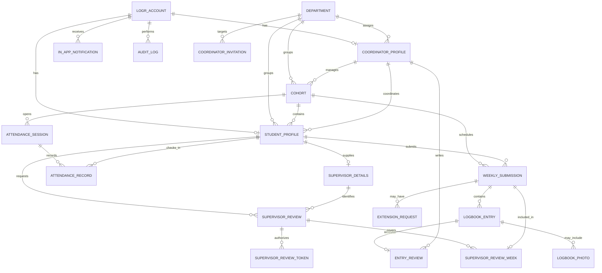
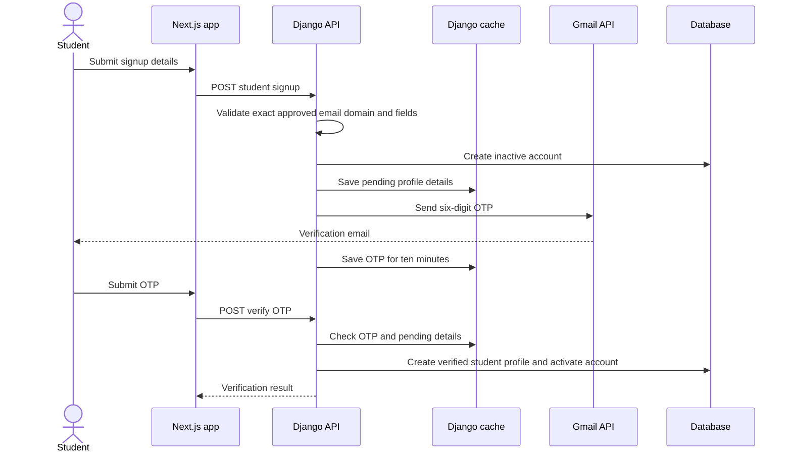
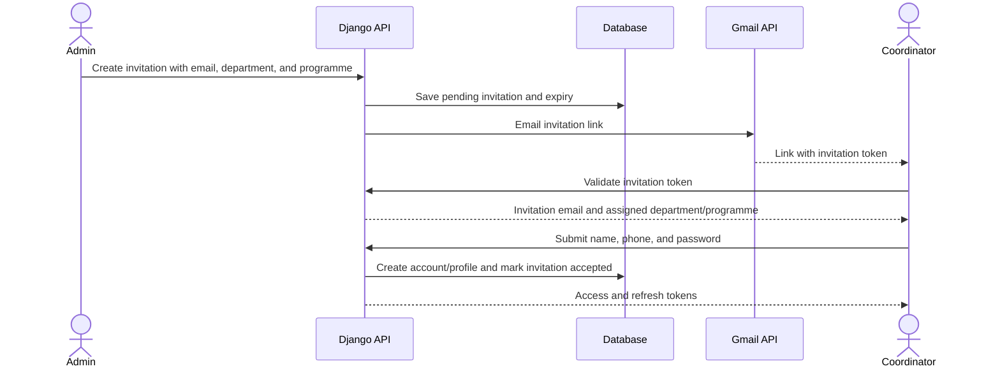

# Logr Technical Report Handoff

This document gives report writers a source-based technical summary of Logr. It describes the code and documented deployment design; it is not a claim that every user flow has passed end-to-end testing.

## 1. System overview

Logr is a web application for recording and reviewing OAU engineering students' SWEP and SIWES placement activities. Students use the web app to maintain logbooks. Coordinators manage cohorts and assess logbook work. SIWES students can request an external supervisor's review and signature through an emailed link. Administrators invite coordinators and oversee accounts and reports.

The frontend sends JSON requests to a versioned Django REST API. The API stores application records in a relational database, uses Django's cache for short-lived values, and connects to Gmail and Cloudinary for external services.

The reminder command is scheduled separately from the web service. The documented production setup uses a Render Cron Job; it does not require Celery or Redis.

## 2. Technology stack

| Layer | Technologies and role |
| --- | --- |
| Web client | Next.js 16, React 19, TypeScript, and Tailwind CSS 4 |
| API | Python, Django 6.1, Django REST Framework, and SimpleJWT |
| Database | PostgreSQL when `DATABASE_URL` is configured; SQLite otherwise |
| Authentication | Custom `LogrAccount`, email login, password hashing through Django, and JWT access/refresh tokens |
| Email | Gmail API using an OAuth 2.0 Desktop client for the shared sender |
| Media | Cloudinary for logbook photos and supervisor signature images |
| Short-lived state | Django cache; local-memory by default, database cache when configured |
| Scheduled processing | `send_deadline_reminders` Django management command, intended for a Render Cron Job |

The Django user model is `LogrAccount`, based on `AbstractBaseUser`. Student and coordinator information is held in separate profile models. Django's `PermissionsMixin` is not used; admin access is based on superuser fields and explicit API permission classes.

## 3. Backend organization

| Location | Responsibility |
| --- | --- |
| `backend/settings.py`, `backend/urls.py` | Django configuration, integrations, and `/api/v1/` route mounting |
| `backend/auth/` | Accounts, profiles, departments, OTP signup, login, password flows, coordinator invitations, and authentication serializers |
| `backend/management/` | Cohorts, attendance, logbooks, extensions, grading, SIWES supervisor reviews, notifications, admin workflows, and reminders |
| `scripts/authorize_gmail_sender.py` | One-time local OAuth authorization for the shared Gmail sender |
| `manage.py` | Django development and management command entry point |

See [backend/README.md](backend/README.md) for installation and environment setup. Endpoint contracts remain in the [Frontend Guide](FRONTEND_GUIDE.md).

## 4. Main data model

The models separate login credentials from role-specific profile data. Department and programme information is reused by students, coordinators, invitations, and cohorts.

Key model groups:

- **Accounts:** `LogrAccount`, `StudentProfile`, `CoordinatorProfile`, `Department`, and `CoordinatorInvitation`.
- **Cohort and logbook:** `Cohort`, `CohortHoliday`, `WeeklySubmission`, `LogbookEntry`, `LogbookPhoto`, `EntryReview`, and `ExtensionRequest`.
- **SWEP attendance:** `AttendanceSession` and `AttendanceRecord`.
- **SIWES external review:** `SupervisorDetails`, `SupervisorReview`, `SupervisorReviewWeek`, and `SupervisorReviewToken`.
- **Operations:** `InAppNotification` and `AuditLog`.

`StudentProfile` has optional cohort and coordinator links. A coordinator-created cohort is matched to students by department and programme; eligible students without a cohort are attached automatically by the backend.

## 5. Core workflows

### Student signup and email verification

The OTP is a six-digit value stored in Django cache for ten minutes. Pending signup details are cached for up to 24 hours. The student profile is created only after a valid OTP is submitted. Email-domain validation is performed in the signup serializer and checks an exact configured domain.

### Coordinator invitation and setup

Invitations are valid for 72 hours. The email, department, and programme come from the invitation; the coordinator supplies their name, phone, and password when accepting it.

### Cohort, logbook, and grading

1. A coordinator creates a cohort for their assigned department and programme, with its session dates and schedule.
2. The backend attaches eligible students who match the department and programme and do not already belong to a cohort.
3. Students save dated logbook entries. Each entry can include activities, skills, review text, and optional photos.
4. Students submit a weekly logbook for review. A coordinator reviews entries, gives the numeric rating and comment, then finishes the week or returns it for correction.
5. A student may request an extension under the cohort's request rules; the coordinator approves or rejects it.

Numeric logbook grading belongs to the coordinator. Supervisors do not give scores.

### SWEP attendance

The coordinator opens a short-lived attendance session for an active SWEP cohort. The code is shown to the coordinator while active; the database stores a salted hash. A student submits the code, and the backend checks the session expiry and limits incorrect attempts. Attendance is not available for SIWES students.

### SIWES supervisor review and signature

The student submits supervisor contact details and requests review for eligible submitted logbook weeks. The backend saves the contact details for reuse, creates a review batch and sends the supervisor a one-use link. The external supervisor does not need an account. They review and sign the selected weeks; the coordinator can then see the review. Signature images are stored through Cloudinary. The token is stored as a hash and expires after 14 days. Supervisors provide a review and signature only, with no numeric score.

### Notifications and reminders

In-app notifications are database records associated with a user. The API supports listing and marking notifications as read. Event workflows create notices for submissions, extensions, reviews, and other actions. The reminder management command also creates scheduled in-app reminders and sends eligible 24-hour deadline reminder emails. The deployment guide schedules the command every five minutes using Render Cron.

## 6. Authentication and data handling

- Protected API requests use JWT access tokens in the `Authorization: Bearer` header.
- Admin endpoints require a superuser; coordinator and student endpoints check the corresponding profile/role.
- Student signup requires a configured institution email domain. Coordinator accounts are created from an admin-issued invitation.
- Passwords are set using Django's `create_user()`/`set_password()` flow and Django's configured password validators.
- OTPs and pending signup values are held in the cache with expiry times. Attendance codes are hashed in the database and the active plain code is held temporarily in cache for the coordinator.
- Supervisor review tokens are stored as hashes and are single-use. Coordinator invitation tokens are stored on the invitation record and expire after 72 hours.
- Uploaded images use Cloudinary. The API returns short-lived signed URLs where private access is needed.

The local default cache is process-local memory. Deployment instructions recommend database cache when values must survive restarts or be shared between processes.

## 7. Feature inventory and evidence level

The table below records implementation visible in source. It does not mark a feature as fully verified in the deployed application.

| Feature | Source implementation | Evidence available for this handoff |
| --- | --- | --- |
| Student signup, OTP, login, password flows | `backend/auth/` views, serializers, and models | Source reviewed; Gmail delivery was previously blocked by a disabled Gmail API. Successful post-enable delivery has not been confirmed here. |
| Coordinator invitations and account acceptance | Invitation views, `CoordinatorInvitation`, and coordinator profile creation | Team reported sending and accepting an invitation during manual testing; this handoff did not independently repeat the test. |
| Cohorts and automatic student attachment | `Cohort` model and coordinator cohort view | Source reviewed; deployed cohort creation and assignment still need test evidence. |
| Logbook entries, weekly submissions, grading, and extensions | Management models and corresponding API views | Source reviewed; end-to-end frontend behavior needs verification. |
| SWEP attendance | Attendance session/code and attendance record models/views | Source reviewed; no independent runtime test in this handoff. |
| SIWES supervisor batches and signature | Supervisor review models/views and Cloudinary integration | Source reviewed; a frontend/backend response mismatch is noted below. |
| In-app notifications and scheduled reminders | Notification model/views and `send_deadline_reminders` command | Source and deployment instructions reviewed; production schedule execution is not independently confirmed. |

### Integration checks before describing the product as fully end-to-end

Source inspection found frontend API calls with mock fallbacks and contracts that need reconciliation before report writers claim that every screen is connected to live data:

1. The frontend student API calls routes such as `/student/dashboard/` and `/student/weeks/{n}/`; the backend routes are under `/student/logbook/` and `/student/logbook/weeks/{n}/`. Several student API methods fall back to sample data after a failed request, so a populated screen is not by itself evidence of live data.
2. The SIWES review endpoint returns an object with `unsentWeeks` and `batches`, while the current frontend client/page treats the response as a batch array. The frontend's send call also uses `/student/supervisor-reviews/send/` with camelCase fields, while the backend POST route is `/student/supervisor-reviews/` and its serializer expects `name`, `email`, `phone`, and `organisation`.
3. The coordinator dashboard backend response was recently expanded to match the screen's expected data shape. That change still needs deployment and runtime verification.

Before using screenshots or demo recordings in the report, developers should confirm that they show live API data and capture the tested API/service environment. Keep mock/demo screens clearly identified as mock data.

## 8. Material for report writers to request from developers

- Screenshots or short recordings of each role's completed, live-tested flows.
- An ER diagram or system architecture image if the report template requires a non-Mermaid diagram.
- Test cases and results, including failed cases and the date/environment of each run.
- Deployment evidence: active services, database/cache configuration, Gmail delivery, Cloudinary uploads, and reminder schedule runs.
- Known limitations and future work, separated from implemented features.
- The developers' agreed scope, individual contributions, and any user feedback or evaluation results.

## 9. Reference documents

- [Root README](README.md): project overview, all stacks, and local startup.
- [Backend README](backend/README.md): backend installation, configuration, and use.
- [Frontend Guide](FRONTEND_GUIDE.md): endpoint paths, requests, responses, and error behavior.
- [Deployment To Do](DEPLOYMENT_TO_DO.md): Render, Gmail OAuth, cache, migrations, and reminder setup.
- [Authentication Execution Plan](AUTH_EXECUTION_PLAN.md)
- [Management Execution Plan](MANAGEMENT_EXECUTION_PLAN.md)
